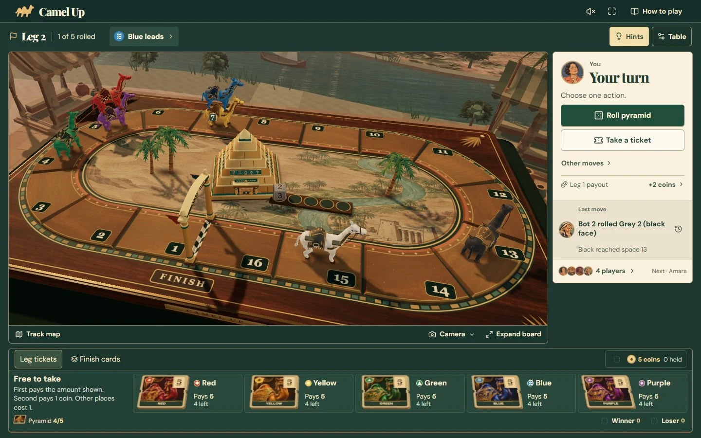
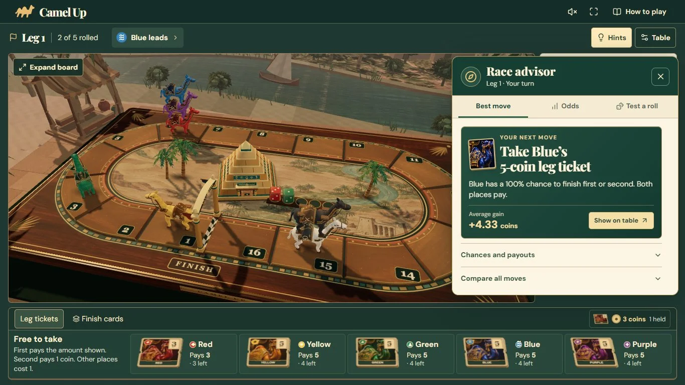

# Camel Up

A local 3D adaptation of the second-edition base game. The game, artwork, fonts, sound, rules, and bot decisions run on the host PC. Guests play in their browsers. [Browser usability review](./UX-REVIEW.md)



## Play on Windows

Double-click **Play Camel Up.cmd**. Keep the host window open while playing. The launcher opens the game at [the local table](http://127.0.0.1:4174/).

On a fresh installation, the launcher needs Node.js 22.18 or newer and internet access to install the locked dependencies. Subsequent launches work offline. The current workspace contains an installed, built copy.

- **Play Solo** lets you choose 2–7 opponents, a table difficulty, and a difficulty for each bot.
- **Host LAN Game** lets you reserve human seats and add bots. On the same Wi-Fi or Ethernet network, guests scan the lobby QR or open the displayed address. If the PC has more than one network adapter, the lobby lets you choose its Wi-Fi or Ethernet address. On a Windows Firewall prompt, private network access is needed for other devices to reach the host.
- Choose a portrait when taking a seat. In LAN setup the host can designate the youngest player's seat to start.
- To resume, reopen the launcher and select **Resume table** in the same browser. Guests can reopen the original invitation in their original browser. The host writes each turn to `saves/`.

## At the table

Each roll releases a die and cuts to the moving stack at hoof level. The running camel carries its passengers, reacts to spectator tiles, and settles onto the track before the camera returns to your previous view. Open **Camera** to change the automatic shot, orbit, or follow a particular camel. **Skip shot** returns you to live play.

The field uses more of the screen by default. **Expand board** gives the track a full-width view with turn controls nearby. **Show full table** restores the usual layout, and **Tickets & hand** takes you directly to your cards.

The top strip shows the leg, how many dice have been rolled, and the leading camel. Select the leader for the complete standings and remaining dice. The turn area names the current player and shows the latest public move. Open **Players** to inspect a seat’s holdings and recent move, or **Table** for scoring, the race log, and display settings.

On your turn, choose **Roll pyramid** or **Take a ticket**. Taking a leg ticket is free. If its camel leads at leg scoring, it pays the printed amount. Second place pays one coin and any other place costs one. **Other moves** opens finish betting, spectator placement, and partnerships when available. The tray shows one deck at a time. A finish bet stays pending until you choose winner or loser and confirm. The wallet shows your coin balance and tickets held.

Scroll normally with the mouse wheel or swipe vertically on a phone. **Back to race** returns from the cards to the board. Camera orbit can be enabled separately. In a dialog, scroll the contents and use its fixed Close button to return to the previous position.

**Sound settings** opens a mixer for the original plucked-string and percussion score, dice, hoofbeats, and scoring cues. Sound starts muted. Choose 96, 120, or 144 BPM and set music and effects volumes independently. The mixer pauses in hidden tabs and remembers preferences locally. Listen to the [96 BPM table mix](./previews/table-music.wav).

**Track map** opens all 16 numbered spaces. Select a space to inspect its stack from top to bottom or see which spectator is there. During spectator placement, rings mark legal destinations. Select a blocked space for the reason. On the map, confirm a legal placement to spend your turn.

The in-game rules reference works offline. Each rule includes a link to its printed page and a video timestamp for use when connected. [Rule-by-rule audit and worked examples](./RULES-AUDIT.md) · [Official English rulebook](https://cdn.svc.asmodee.net/production-asmodeeca/uploads/2023/08/EN-Camel-Up-2-0-Rules.pdf) · [Original artwork and asset prompts](./ART.md)

## Race advisor



Open **Hints** and read **Best move** for the recommended action, its reason, and its average coin gain. Open **Chances and payouts** for the outcome breakdown and model details. **Show on table** highlights the matching ticket, card, space, or control. You decide whether to play it. **Compare all moves** reveals two nearby alternatives and the reasoning for every legal choice.

In **Odds**, choose **This leg** or **Whole race**, then the finishing place you want to compare. The five camels are ranked by that chance on a common 0–100% scale. **Test a roll** lets you choose any remaining die, number, and grey pip color to preview stack movement, spectator effects, and the resulting lead. [See the phone odds view](./previews/camel-odds.webp)

Leg odds enumerate every remaining roll sequence with the current spectator tiles, including from the first turn. Full-race forecasts use 4,096 seeded Monte Carlo races when the result extends beyond the exact branches. Move recommendations rank expected coin gain under the stated assumptions. Spectator placements use paired trials against the same dice, and hidden finish colors are sampled from each player’s possible hand.

Calculations run locally in a separate worker when the panel is open. A turn change invalidates the old forecast. During another player's turn, the panel shows table odds without providing that seat’s private recommendations.

## Development and verification

From this directory:

```sh
npm ci
npm run build
npm start
```

`npm test` runs the rules, bot, movement, advisor, and LAN suites. `npm run qa:advisor` exercises field expansion, forecasts, hypothetical rolls, live updates, and mobile hints. `npm run qa:flows` plays through setup, card selection, and reconnection as separate host and guest browsers. `npm run qa:playback` verifies that a guest receives missed turns in order and keeps finish bets private. `npm run qa:browser` measures both WebGL canvases during complete eight-seat roll sequences and checks touch and keyboard input. The browser checks create temporary rooms. Set `QA_CHROME` to use a particular Chrome executable.

`npm run bench:bots -- 24 36` runs 24 reproducible seeds with all six seat permutations per seed. Bots receive the same view their seat would receive on LAN and simulate with their own random stream.

`npm run bench:advisor -- 24 18001 6` runs 96 matched pairs, rotating the advised seat across 3-, 4-, 6-, and 8-player tables. Each pair uses the same starting seed and bot lineup. The script compares the current hints with a challenger that tests late or close decisions by rolling out opponents’ turns, and reports the paired 95% interval for the change in tie-adjusted win rate.

## Measured performance

Chrome 157 on an Intel Iris Xe laptop with a Core i7-12700H rendered three full 2.6-second shots of an eight-seat table moving a seven-camel stack. At 1440 × 900 the final table averaged **59.5 FPS**, with a 95th-percentile frame interval of **18.6 ms** and roll feedback in **28–58 ms**. Both canvases stopped drawing at rest.

At a 390 × 844 touch-emulated viewport on the same laptop GPU, the table averaged **60.1 FPS**, with roll feedback in **33–47 ms**. These measurements cover the phone layout and touch behavior. Physical phone frame rate remains unmeasured.
