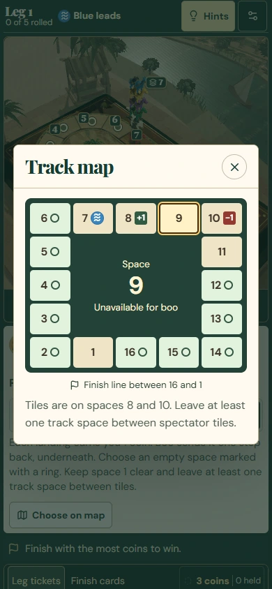

# Camel Up • 2018 second-edition base game

The printed English rules are the authority for this implementation. The page numbers below are printed on the sheets. Both publisher PDFs put printed page 1 last, so the links account for the different PDF page order. In the game, open **How to play** and expand any rule to find its page and a timestamped demonstration. [Original English rules][original] · [Lookout English reprint][reprint] · [Publisher's inventory and teaching video][product]

## The spectator question

If one player's cheer is on 8, another player cannot put a cheer **or** a boo on 7, 8 or 9. Space 10 can be legal. The intervening space may contain camels. In a three-seat LAN game, attempts at 7, 8 and 9 were rejected and left the turn intact. A boo on 10 succeeded. Space 9 between those two tiles stayed unavailable. [Printed p. 4][p4] · [Meeple University, 6:42](https://www.youtube.com/watch?v=5oX4Q7AcpxQ&t=402s) · [Second tutorial, 5:25](https://www.youtube.com/watch?v=VqwYR_gpgvk&t=325s)

**Relocating your own tile.** The book permits a move to a *different* legal space. We apply the spacing rule to the resulting board. Lifting your only tile from 8 can free 7 or 9 for that same tile, provided all other restrictions hold. Switching its face while leaving it on 8 is illegal. Neutral rings on the table now identify possible destinations. The printed +1 and −1 identify placed pieces. [Printed p. 4][p4]

## Rule-by-rule verification

| Subject | What the check exercises | Authority |
|---|---|---|
| Board and box | All 16 numbered spaces, the finish boundary between 16 and 1, five racing colors, two crazy camels, six dice, five pyramid tickets, 20 leg tickets, 40 finish cards and eight player sets. The inventory also lists the marker, pyramid and both coin denominations. | [Components][product] · [Setup illustration][p2] |
| Starting position | A reproducible opening deals green, yellow and red to 1, blue and purple to 3, black to 15 and white to 16. Racers sharing a square can start in any stack order. Every seat starts with five distinct colors and 3 EP. | [Printed p. 2][p2] · [Setup demonstration](https://www.youtube.com/watch?v=5oX4Q7AcpxQ&t=88s) |
| Turns and marker | One action per turn clockwise. LAN setup lets the host identify the youngest seat. The player following the fifth roller opens the next leg. A partnership adds a fifth action at six or more seats. | [Setup][p2] · [Turns][p3] · [Leg reset][p5] · [Partnerships][p6] |
| Ticket market | Taking the displayed top ticket costs zero. Each color supplies 5, 3, 2 and 2 EP in order. The same seat may take several tickets. An empty stack rejects another draw. | [Setup][p2] · [Taking a ticket][p3] · [Scoring][p5] |
| Dice and pyramid | A die leaves the available set once per leg. The fifth draw resolves its movement before settlement. One die stays inside. The digital dice show numerals, including the rolled black or white face on grey. The animation reads the engine's roll, even when a carrying exception changes which camel moves. | [Leg overview][p3] · [Pyramid action][p4] · [Fifth draw][p5] |
| Stacks and rank | Pieces above a mover travel with it, in order. The purple-two illustration places purple and green atop yellow. Stacks are read top first for standings, skipping crazy camels. | [Ranking][p3] · [Illustrations][p4] |
| Grey die | Both colored faces, each numeral, one crazy camel carrying racers, two directly stacked crazy camels, and racers separating them are covered. The grey die can end the race in reverse. | [Printed p. 4][p4] · [Backward finish][p5] |
| Spectator payments and direction | Repeated landings pay the owner immediately. The tile remains. A cheer lands on top. A boo inserts the moving unit underneath. Both work relative to the mover's direction. | [Illustrated examples][p4] · [Video creator's correction](https://www.meepleuniversity.com/2021/12/22/camel-up-second-edition-how-to-play-a-board-game-tutorial/) |
| Money and leg receipts | Each seat receives an itemized net leg result, with a zero balance floor. Martina's pictured tickets yield +5, +2, +1, −1, +1 and +1, totaling **9 EP**. Players can inspect their own wallet. Opponents can see coin piles during play. | [Money][p3] · [Worked example][p5] |
| Finish cards and privacy | Each original color can be used once across both piles. Commitments preserve play order and conceal opponents' colors in live LAN views, reconnection and turn playback. | [Setup][p2] · [Finish cards][p5] |
| Partnerships | Both seats must still be available. Each makes its own optional copy decision against the other's original tickets. Tests cover a pyramid ticket, a declined losing ticket, exhausted partners and returning cards. | [Printed p. 6][p6] · [Video, 10:39](https://www.youtube.com/watch?v=5oX4Q7AcpxQ&t=639s) |
| Finish and cleanup | A crossing in either direction settles the final leg exactly once, including on the fifth draw. Backward-carried racers rank at the rear. Final stacks remain visible while the leg supplies and partnership cards return. | [Printed p. 5][p5] · [Printed p. 6][p6] |
| Final awards and ties | The pictured winner pile yields −1, −1, +8, +5. The loser pile then yields +8, −1, −1, +5, +3. Additional correct cards pay 2 and then 1 as appropriate. A wrong card leaves the next correct-card award available. Shared highest balances produce joint winners. | [Printed p. 5][p5] · [Video, 11:49](https://www.youtube.com/watch?v=5oX4Q7AcpxQ&t=709s) |

## Hints and digital choices

Solo seats the human first and adds bots to reach the published 3–8 seats. The 3D course uses original art and a different physical silhouette. Both board views use the same numbered route, finish line and stack data. The bank handles making change automatically. The printed game allows people to stack and voluntarily disclose their coins. This version displays opponents' denomination piles during play, and exact totals at the finish. [Setup diagram][p2] · [Money][p3]

The hint worker draws possible moves from the same legal action list that the host enforces. A hypothetical spectator layout must match a legal relocation or placement. The leg calculation enumerates remaining draws with the current tiles fixed. Longer race forecasts and move comparisons use simulations where needed. Private finish colors remain unknown. Five face-down cards from the same seat in one pile contain precisely one of each color, which caps the next correct award at 5 EP. A recommendation maximizes modeled extra coins. Other players can still change the board on later turns. [Five-card hands][p2] · [Finish scoring][p5]

## Browser play and interface checks

- Three seats played a six-leg solo race through all five committed finish cards, with final totals of 23, 11 and 10. A separate LAN host and guest completed five legs with a bot, revealed all four finish bets and saw identical final totals after reload.
- A six-seat race with real Easy, Medium and Hard workers ran for 56 actions over four legs. The human consulted hints in each leg. Bots bought tickets, bet on the finish, placed tiles, rolled, partnered and chose copies. Replaying every accepted action reproduced the exact stacks, dice-generator state, balances, reveal order and two-way tie at 20 EP.
- The independent map check opened and clicked all 16 spaces at widths of 1440, 390 and 320 CSS pixels. All had nonoverlapping hit areas of at least 44 × 44. It read all seven camels top first, inspected blocked space 9, and verified the saved revision changed only after confirming the legal boo on 6.
- A second reviewer played 27 rolls through six legs and sampled 1,440 physical board points across 45 camera states. A visible numeral initially selected a neighboring stack in Trackside view. After correcting the hit tests, the reviewer recorded zero wrong-space picks. A separate eight-seat LAN race finished with two humans and six bot workers.
- A card reviewer exercised all five leg tickets and all five private finish cards in both 2D and 3D at 1366 × 768 and 390 × 844. All 40 controls matched their visible cards. Choosing and canceling either finish pile preserved the hand and turn. After correcting the 2D card alignment, the largest measured offset between card art and its target center was 4.83 pixels in 3D and 0.42 pixels in 2D. The pyramid-ticket reserve and both sealed finish piles stayed visible. Expanded score-sheet ticket labels now measure 6.39:1 contrast and signed values 11.68:1 against the paper.
- In a held-out difficulty check, 24 fresh seeds ran in all six seat orders. Tie-adjusted win shares across 144 games were 3.5% Easy, 37.8% Medium and 58.7% Hard. Hard's advantage over Medium was 20.8 percentage points, with an approximate paired 95% interval of 2.8 to 38.8 points. A smaller seed set tied those two tiers. These are outcomes against this particular bot lineup.
- On an Intel Iris Xe laptop, three full eight-seat rolls carrying all seven camels averaged 59.5 FPS at 1440 × 900 in the final build. The 390 × 844 touch-emulated layout averaged 60.1 FPS on the same GPU. Roll-to-feedback times were 28–58 ms on desktop and 33–47 ms in phone emulation. Phone stack inspection, ticket selection and private finish-card controls measured 15–34 ms. Both canvases submitted zero draws during 1.6 seconds at rest. Physical phone GPU performance remains unmeasured.

## Repeat the checks

To repeat the checks, run `npm test` and `npm run build` in this folder. Then use `npm run qa:spectators` for the three-seat placement race, `npm run qa:track` for the map, `npm run qa:cards` for card targeting and receipts, and `npm run qa:races` for complete solo and LAN browser games. Each browser check creates its own temporary rooms.

## Tabletop interface references

The track map gives players a second route to inspect a space obscured by a tall stack. Camera controls and the moving-stack caption now sit outside the numbered surface. Opening the map, inspecting a stack or previewing a finish card leaves the turn unspent. [Elmqvist and Tsigas, 3D occlusion management](https://doi.org/10.1109/TVCG.2008.59) · [Tabletop Simulator, magnification and private inspection](https://kb.tabletopsimulator.com/player-guides/advanced-controls/)

Permanent tiles carry signed values. Empty legal spaces use rings, and a blocked selection explains which rule applies. The map uses generous separate targets at phone widths. These choices address measured wrong-space activations and preserve the appearance of the card table. [Xbox guidance on UI context](https://learn.microsoft.com/en-us/xbox/accessibility/xbox-accessibility-guidelines/114) · [W3C, target size and spacing](https://www.w3.org/WAI/WCAG22/Understanding/target-size-minimum) · [Riot Games, visual clarity](https://www.leagueoflegends.com/en-us/news/dev/clarity-in-league/)

[original]: https://cdn.svc.asmodee.net/production-asmodeeca/uploads/2023/08/EN-Camel-Up-2-0-Rules.pdf
[reprint]: https://www.lookout-spiele.de/upload/en_camelup.html_CamelUp_PZE30070_Rules_EN_WEB_240305.pdf
[product]: https://www.asmodee.ca/en/product/camel-up/
[p2]: https://cdn.svc.asmodee.net/production-asmodeeca/uploads/2023/08/EN-Camel-Up-2-0-Rules.pdf#page=1
[p3]: https://www.lookout-spiele.de/upload/en_camelup.html_CamelUp_PZE30070_Rules_EN_WEB_240305.pdf#page=2
[p4]: https://cdn.svc.asmodee.net/production-asmodeeca/uploads/2023/08/EN-Camel-Up-2-0-Rules.pdf#page=3
[p5]: https://www.lookout-spiele.de/upload/en_camelup.html_CamelUp_PZE30070_Rules_EN_WEB_240305.pdf#page=4
[p6]: https://cdn.svc.asmodee.net/production-asmodeeca/uploads/2023/08/EN-Camel-Up-2-0-Rules.pdf#page=5
